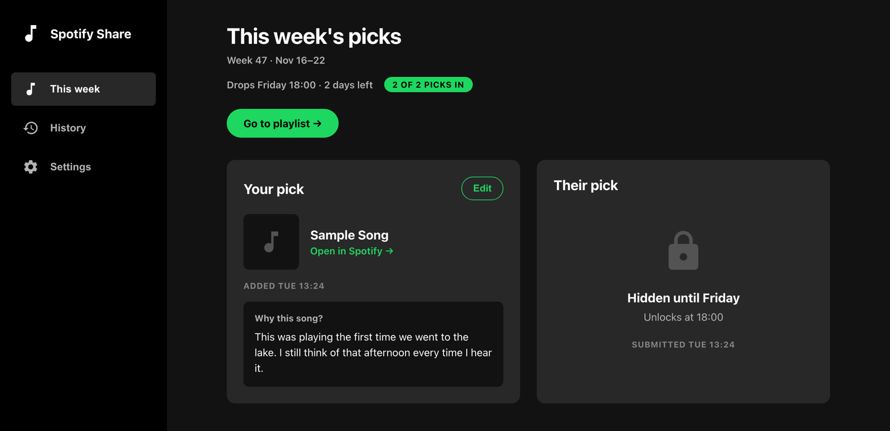
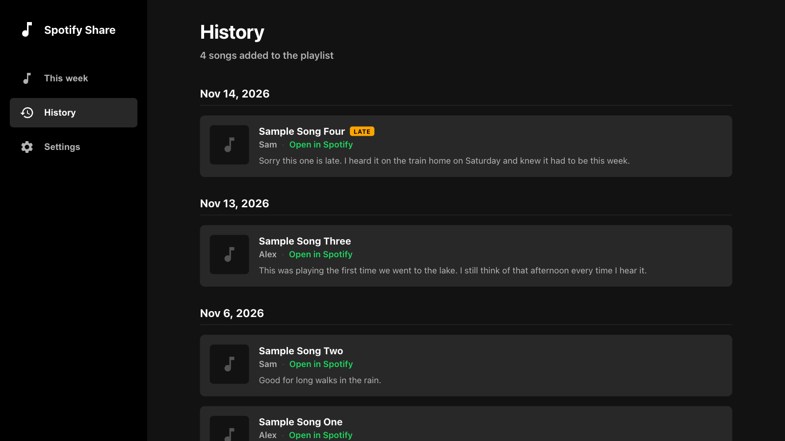

# Spotify Share

A weekly song swap for two people, delivered to a shared Spotify playlist every Friday.



*The **This week** page, shown with sample data.*

## About the project

Spotify Share turns sharing music into a small weekly ritual. Each week, you and your partner each pick one song and write a few words about why you chose it. Neither of you can see the other's pick until Friday at 18:00 Berlin time, when both songs appear in your shared playlist at the same time.

The point is the reveal and the reason behind each song, not just the song itself. Because each pick is added with its owner's own Spotify account, the playlist also becomes a record of who shared what, week by week.

Spotify Share is a personal project for two users. It is not a multi-user service.

## Get started

### Prerequisites

- Node.js 18 or later
- A [Supabase](https://supabase.com) project
- A [Spotify for Developers](https://developer.spotify.com/dashboard) app
- A Spotify playlist that both users can add to

### Install and run

```bash
git clone https://github.com/teod05/spotify-share.git
cd spotify-share
npm install
cd client && npm install && cd ..
cp server/.env.example server/.env
```

Fill in your Supabase and Spotify values in `server/.env`. Then start the server and the client in two terminals:

```bash
npm run dev:server
```

```bash
npm run dev:client
```

Open http://127.0.0.1:5173 and you see the sign-in page.

The database tables, the Spotify app and the two users need a few more steps. The [Getting started](docs/getting_started.md) tutorial walks you through all of them, from a fresh clone to your first saved pick, in about 30 minutes.

## Features

- **One pick a week.** Paste a Spotify track link and write up to 280 characters about why you chose it. You can change your pick until the drop.
- **A hidden reveal.** You see that your partner has picked, but not what. A countdown shows the time left until Friday 18:00 Berlin time.
- **The Friday drop.** Both picks are added to the shared playlist at the same time, each with its owner's Spotify account.
- **Late picks.** Missed Friday? Until Sunday 23:59 Berlin time, you can still add a pick for the past week. It goes into the playlist right away.
- **History.** Browse every past song with its reason, and see which picks were late.



*The **History** page, shown with sample data.*

## Run the tests

```bash
node server/utils/time.test.js
node server/utils/drop-guard.test.js
node --env-file=server/.env server/utils/spotify.test.js
```

The Spotify test needs the env file because it loads the Supabase client.

## Documentation

- [Getting started](docs/getting_started.md) is a step-by-step tutorial that takes you from a fresh clone to your first saved pick, with screenshots of each screen.
- [About the Friday drop](docs/about_the_friday_drop.md) explains why picks stay hidden until Friday, how the weekly drop and late picks work, and why the database schedules the drop instead of the server.
- [Deploy Spotify Share to Render](docs/DEPLOY.md) shows how to host the app on Render's free plan and schedule the Friday drop with Supabase. It also covers testing the drop and troubleshooting.

## Project structure

```text
client/   React front end (Vite)
server/   Express API, Spotify OAuth and the Friday drop job
docs/     Tutorial, concepts and deployment guide
```

## Contributing and contact

Spotify Share is built and maintained by Benediktas as a personal project and a CODE University documentation assignment.

This project is built for two people, so outside contributions are not expected. You are welcome to fork it under the MIT License and run your own copy. If you find a bug or have a question, open an issue on GitHub.

## License

Spotify Share is released under the [MIT License](LICENSE).
