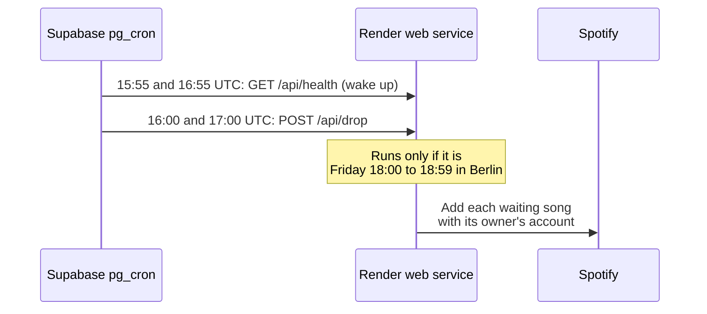

# Deploy Spotify Share to Render

Put Spotify Share online for free and set up the Friday drop so that it runs on time every week.

In this guide, you host the app on [Render](https://render.com)'s free plan and use Supabase to start the Friday drop. When you finish, both users can open the app from any device, and both picks reach your playlist every Friday at 18:00 Berlin time.

This guide takes about 30 minutes. It is written for developers who have already run the app on their own computer.

## How the deployed app fits together

Render runs a single web service. It serves both the web app and the API from one address.

Render's free plan puts the service to sleep after about 15 minutes without visitors. A sleeping service can't keep its own schedule. That's why Supabase starts the drop instead, using *pg_cron* (a scheduler inside the database) and *pg_net* (a way for the database to send web requests).



*Every Friday, Supabase wakes the app and asks it to run the drop.*

The drop endpoint is called twice because Berlin changes its clocks in summer and winter. One of the two calls always lands at 18:00 Berlin time, and the app skips the other one. To learn more, see [About the Friday drop](about_the_friday_drop.md).

## Prerequisites

Before you start, make sure you have:

- **Completed [Getting started](getting_started.md).** You need its Spotify app, Supabase project with tables and users, and playlist ID.
- **The code in your own GitHub repository.** Render deploys from GitHub. If you cloned the original repository, fork it first.
- **A Render account.** The free plan is enough.
- **Node.js** on your computer, to create a secret key in step 1.

## Step 1: Create a drop secret

The drop endpoint only runs when the request includes a secret key. This stops strangers from starting your drop.

Create a long random key:

```bash
node -e "console.log(require('crypto').randomBytes(32).toString('hex'))"
```

Copy the result and keep it somewhere safe. You use it in step 2 and step 5.

## Step 2: Create the web service on Render

1. Open the [Render dashboard](https://dashboard.render.com) and select **New** > **Web Service**.
2. Connect your GitHub account and choose your Spotify Share repository.
3. Fill in the settings:

   | Setting | Value |
   | --- | --- |
   | **Name** | Any name, for example `spotify-share`. It becomes part of your address. |
   | **Language** | `Node` |
   | **Branch** | `master` |
   | **Build Command** | `npm run build` |
   | **Start Command** | `npm start` |
   | **Instance Type** | **Free** |

4. Under **Environment Variables**, add these values. Replace `YOUR_APP` with the name from the table above.

   ```bash
   SUPABASE_URL=https://YOUR_PROJECT.supabase.co
   SUPABASE_SECRET_KEY=YOUR_SERVICE_ROLE_KEY

   CLIENT_ID=YOUR_SPOTIFY_CLIENT_ID
   CLIENT_SECRET=YOUR_SPOTIFY_CLIENT_SECRET
   REDIRECT_URI=https://YOUR_APP.onrender.com/callback

   FRONTEND_URL=https://YOUR_APP.onrender.com
   SPOTIFY_PLAYLIST_ID=YOUR_PLAYLIST_ID

   NODE_ENV=production
   DROP_SECRET=YOUR_DROP_SECRET
   ```

   `NODE_ENV=production` tells the server to serve the web app and to use secure cookies. Don't set `ENABLE_CRON`. The schedule inside the server stays off, because Supabase starts the drop instead. You also don't need `PORT`, because Render sets it for you.

5. Select **Deploy Web Service**.

The first build takes a few minutes. When the log shows `Server listening on port`, your app is live at `https://YOUR_APP.onrender.com`.

## Step 3: Add the new address to your Spotify app

Spotify only sends users back to addresses you have approved.

1. Open the [Spotify Developer Dashboard](https://developer.spotify.com/dashboard) and choose your app.
2. Open **Settings** and select **Edit**.
3. Under **Redirect URIs**, add `https://YOUR_APP.onrender.com/callback`. Keep the local address if you still want to run the app on your computer.
4. Select **Save**.

## Step 4: Check that the app works

1. Open `https://YOUR_APP.onrender.com/api/health` in your browser. The page shows `{"ok":true}`.
2. Open `https://YOUR_APP.onrender.com` and sign in as one of your users.
3. Open **Settings** and connect Spotify, if this user isn't connected yet.

If the first page takes up to a minute to load, the service was asleep. This is normal on the free plan.

## Step 5: Store the drop secret in Supabase

Supabase Vault keeps secrets encrypted inside your database. The drop function reads the secret from there, so it never appears in your SQL.

Open the **SQL Editor** in your Supabase project and run this. Replace `YOUR_DROP_SECRET` with the key from step 1:

```sql
select vault.create_secret('YOUR_DROP_SECRET', 'drop-secret');
```

## Step 6: Create the database functions

1. In the Supabase dashboard, open **Database** > **Extensions**. Turn on **pg_cron** and **pg_net**.
2. In the **SQL Editor**, run this script. Replace `YOUR_APP` in both places.

   ```sql
   -- Asks the app to run the drop. The app itself checks the time.
   create or replace function trigger_friday_drop()
   returns void
   language plpgsql
   security definer
   as $$
   declare
     drop_secret text;
   begin
     select decrypted_secret into drop_secret
     from vault.decrypted_secrets
     where name = 'drop-secret';

     perform net.http_post(
       url := 'https://YOUR_APP.onrender.com/api/drop',
       headers := jsonb_build_object(
         'Content-Type', 'application/json',
         'Authorization', 'Bearer ' || drop_secret
       ),
       body := '{}'::jsonb,
       timeout_milliseconds := 120000
     );
   end;
   $$;

   -- Wakes the app up before the drop.
   create or replace function ping_health()
   returns void
   language plpgsql
   as $$
   begin
     perform net.http_get(
       url := 'https://YOUR_APP.onrender.com/api/health',
       timeout_milliseconds := 120000
     );
   end;
   $$;
   ```

The long timeout of 120 seconds gives a sleeping service time to start.

## Step 7: Schedule the drop

pg_cron uses Coordinated Universal Time (UTC). Berlin is one hour ahead of UTC in winter and two hours ahead in summer. So you schedule the drop at both 16:00 and 17:00 UTC, with a wake-up call five minutes before each one.

In the **SQL Editor**, run:

```sql
-- Fridays at 15:55 and 16:55 UTC
select cron.schedule('friday-wakeup', '55 15,16 * * 5', 'select ping_health()');

-- Fridays at 16:00 and 17:00 UTC
select cron.schedule('friday-drop', '0 16,17 * * 5', 'select trigger_friday_drop()');
```

Check that both jobs exist:

```sql
select jobname, schedule, command from cron.job;
```

The result lists `friday-wakeup` and `friday-drop`.

## Step 8: Test the connection from Supabase

You can test the whole chain on any day, without adding songs to the playlist. Outside the Friday drop hour, the app checks the secret and then skips the drop.

1. In the **SQL Editor**, run:

   ```sql
   select trigger_friday_drop();
   ```

2. Wait a few seconds, then look at the response. pg_net sends requests in the background, so the answer is stored in a table:

   ```sql
   select status_code, content::text, created
   from net._http_response
   order by created desc
   limit 1;
   ```

A working setup returns status code `200` and content like this:

```json
{
  "skipped": true,
  "reason": "Not Friday 18:00-18:59 Berlin time (currently Wed 14:00 Berlin)",
  "berlinTime": "2026-11-18T14:00:00.000Z"
}
```

If you see a different status code, see [Troubleshooting](#troubleshooting).

## Optional: Run the drop right now

To add all waiting songs to the playlist immediately, add `?force=true` to the address. This skips the time check.

This is a real drop. It adds every waiting song to your playlist, and you can't undo it from the app.

```bash
curl -X POST "https://YOUR_APP.onrender.com/api/drop?force=true" \
  -H "Authorization: Bearer YOUR_DROP_SECRET"
```

The app answers with a summary:

```json
{
  "success": true,
  "message": "Drop completed",
  "forced": true,
  "total": 2,
  "added": 2,
  "failed": 0
}
```

## Troubleshooting

### The drop endpoint returns an error

| Status code | Meaning | What to do |
| --- | --- | --- |
| `503` | `DROP_SECRET` isn't set on Render. | Add it under **Environment** in Render. Render redeploys the service. |
| `401` | The request has no `Authorization: Bearer` header. | Check the `headers` part of `trigger_friday_drop()`. |
| `403` | The secret doesn't match. | Make sure the Vault secret and `DROP_SECRET` on Render are the same. |
| No row in `net._http_response` | The request didn't finish. | Check that `YOUR_APP` is correct in the function, then run the test again. |

### The drop didn't run on Friday

1. Look at the job history in the **SQL Editor**:

   ```sql
   select jobname, status, return_message, start_time
   from cron.job_run_details
   order by start_time desc
   limit 10;
   ```

2. Open **Logs** for your service in Render and look for lines that start with `[Friday Drop]`.

### A song wasn't added

The Render log shows `[Friday Drop] Error processing song` with the reason. The song stays saved, and the next drop tries again. The most common cause is a Spotify connection that no longer works for that user.

### Spotify login fails with a redirect error

The redirect address must match exactly in three places: the Spotify dashboard, `REDIRECT_URI` on Render and the address in your browser. Check for `http` instead of `https` and for a missing `/callback`.

### Supabase paused your project

Supabase pauses free projects after a week without activity. The weekly drop uses the database, which usually keeps the project active. If it pauses anyway, restore it from the Supabase dashboard.

## Summary

You put Spotify Share online. You:

- Created a drop secret and deployed the app as a free web service on Render.
- Added the new address to your Spotify app.
- Created database functions that wake the app and ask it to run the drop.
- Scheduled the drop with pg_cron and tested it without touching your playlist.

From now on, both picks reach your playlist every Friday at 18:00 Berlin time, and the app runs without your help.

## Related links

- [About the Friday drop](about_the_friday_drop.md): why the drop works the way it does.
- [Getting started](getting_started.md): run Spotify Share on your own computer.
- [Render free instances](https://render.com/docs/free): limits of the free plan, including sleep.
- [Supabase Cron](https://supabase.com/docs/guides/cron): more about scheduling jobs in Supabase.
- [Supabase Vault](https://supabase.com/docs/guides/database/vault): how Supabase stores secrets.
