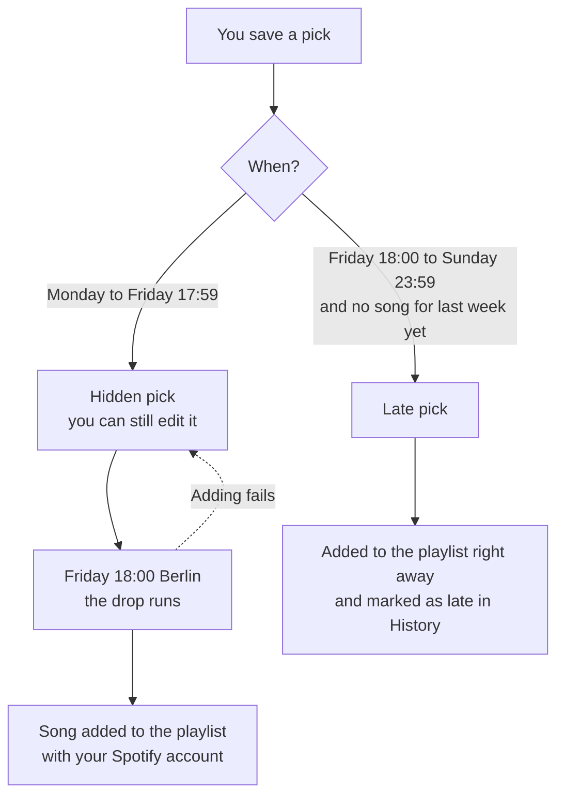
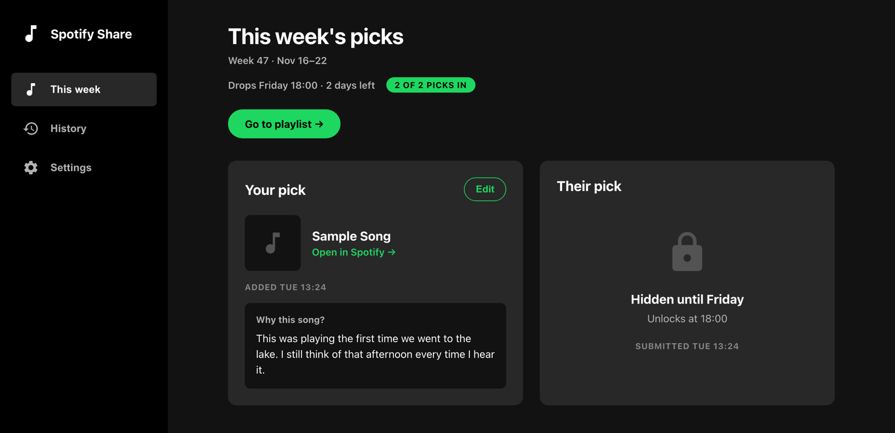
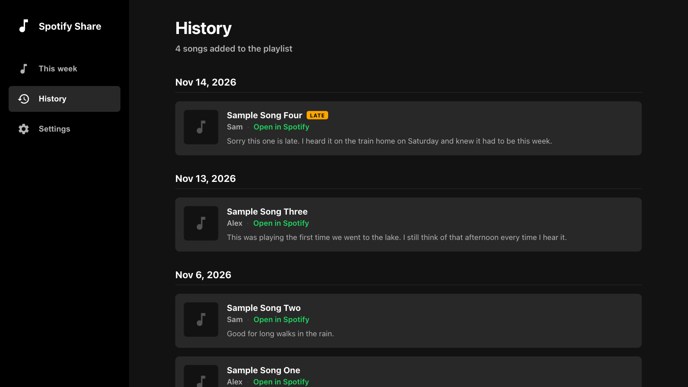

# About the Friday drop

The Friday drop is the moment each week when Spotify Share reveals both picks and adds them to your shared playlist. This page explains what the drop is, why it works the way it does and what that means for you as a user or as a developer who runs the app.

This page is for anyone who wants to understand the app's weekly rhythm. If you plan to change the drop or host the app yourself, the background and details sections are the most useful parts. You don't need to know the code to follow it.

This page explains concepts only. For setup steps, see [Getting started](getting_started.md). For hosting steps, see the [deployment guide](DEPLOY.md).

## What is the Friday drop

The *Friday drop* is a scheduled job that runs every Friday at 18:00 Berlin time. It takes every pick that isn't in the playlist yet and adds it to the shared Spotify playlist. Each song is added with its owner's own Spotify account.

Until the drop, each of you can see that the other has picked, but not which song or why.

## Background

Spotify Share started from a simple idea: sharing a song should feel like a small event, not a message you scroll past. A daily or instant swap would turn into a feed. A weekly reveal gives both of you something to look forward to and a reason to choose carefully.

Two decisions follow from that idea:

- **The picks stay hidden until a fixed time.** If either of you could see the other's song early, the reveal would lose its point.
- **The time is the same for both of you.** The drop uses one time zone (Berlin) so that "Friday at 18:00" means the same moment for both users.

## How the drop works

The drop moves each pick through a few states. The diagram shows the path a pick takes from the moment you save it.

*The life of a pick. A dashed line means the pick waits for the next drop.*

### Your pick stays hidden

Each of you has at most one waiting pick at a time. Saving again replaces it, so you can change your mind until the drop.

The server never sends your partner's song or reason to the browser before the drop. The **This week** page only learns that your partner has picked and when. This is a deliberate choice: hiding the pick only on screen would still let anyone with browser tools read it.

*Before the drop, your partner's pick shows only a lock and the time it was saved.*

### The drop adds every waiting song

At 18:00 Berlin time, the drop finds every song that isn't in the playlist yet and adds them one by one. Once a song is added, the app saves the time it was posted. That time is how the app tells waiting songs from posted ones.

The drop handles each song on its own. If one song fails, for example because a Spotify connection expired, the other song is still added. The failed song keeps waiting and goes out with the next drop.

### Songs are added with your own account

Spotify Share doesn't add songs from a shared app account. When you connect Spotify, you allow the app to add songs to playlists in your name. At the drop, the app uses that permission to add your song with your account.

The result is that the playlist shows who added each song. Over time, the playlist becomes a record of who shared what.

### Late picks and the grace window

Missing a Friday shouldn't mean missing a week. The *grace window* runs from the Friday drop until Sunday 23:59 Berlin time.

If you save a pick in the grace window and you have no song for the past week, the pick counts for that week. The app adds it to the playlist right away, because that week's drop has already happened. In **History**, the pick is marked as late.

*Sam missed the Friday drop on November 13 and added a late pick on Saturday.*

If you already have a song for the past week, a pick you save in the grace window counts for the coming week and waits for the next drop.

## Why the server doesn't run the drop itself

The obvious way to run a weekly job is a timer inside the server. Spotify Share can do this, but it's turned off by default.

The reason is hosting. The recommended host, Render's free tier, puts the server to sleep after about 15 minutes without visitors. A sleeping server can't run its own timer, so the drop would often be missed.

So in production, the database starts the drop. Supabase, the database service the app uses, includes *pg_cron*, a scheduler that runs inside the database and never sleeps. On Friday afternoons, pg_cron does the following:

1. It sends a wake-up request to the server five minutes before the drop.
2. It calls the drop endpoint, `POST /api/drop`, with a secret key so that no one else can start the drop.

The endpoint itself checks the time and only runs the drop between 18:00 and 18:59 Berlin time. Any call outside that hour is skipped.

## Why Berlin time needs extra care

pg_cron and most servers count time in Coordinated Universal Time (UTC). Berlin is one hour ahead of UTC in winter and two hours ahead in summer. A single UTC schedule would put the drop at 18:00 for half the year and at 17:00 or 19:00 for the other half.

Spotify Share solves this in two places:

- **The schedule calls twice.** pg_cron calls the drop endpoint at 16:00 and at 17:00 UTC on Fridays. One of those calls lands at 18:00 Berlin time, whatever the season.
- **The server decides.** The server converts the current time to Berlin time before it checks the day and hour. Only the call that lands at 18:00 Berlin time runs the drop, and the other call is skipped.

The same conversion is used everywhere the app works with dates, such as the countdown on the **This week** page and the grace window. This keeps every deadline at the same local time, all year.

## How the drop relates to the rest of the app

- **This week page:** shows your waiting pick, whether your partner has picked and a countdown to the next drop.
- **History page:** shows every posted song, grouped by the date it was posted, with its reason. Late picks have a **LATE** label.
- **Spotify connection:** the drop can only add your song if your Spotify connection still works. **Settings** shows whether you have connected Spotify.
- **Deployment:** the pg_cron schedule, the wake-up request and the secret key are set up in the [deployment guide](DEPLOY.md).

## What this means for you

**As a user:**

- You can change your pick as often as you like until Friday 18:00 Berlin time.
- Your partner can't see your song early, not even with browser tools.
- If you miss Friday, you have until Sunday night to add a late pick.
- If your song doesn't appear after a drop, it isn't lost. It stays saved and the next drop tries again. The most likely cause is a Spotify connection that no longer works, for example because you removed the app's access in your Spotify account.

**As a developer running the app:**

- On a host that sleeps, the drop depends on pg_cron. If pg_cron isn't set up, no drop happens.
- Calling the drop more than once is safe, because posted songs are skipped.
- Spotify Share is built for exactly two users. Adding a third user breaks the logic that finds "your partner".

## Summary

The Friday drop turns song sharing into a weekly reveal. Picks stay hidden on the server until Friday at 18:00 Berlin time. Then each song is added to the shared playlist with its owner's account. A grace window until Sunday night catches missed weeks. Because free hosting sleeps, the database schedules the drop, and the server checks Berlin time so the drop stays at 18:00 all year.

With this background, you can follow the [deployment guide](DEPLOY.md) and understand why each step is there. You can also find out why a song didn't appear after a drop.

## Further reading

- [Getting started](getting_started.md): run Spotify Share on your computer and save your first pick.
- [Deployment guide](DEPLOY.md): host the app on Render and schedule the drop with pg_cron.
- [Supabase Cron](https://supabase.com/docs/guides/cron): the scheduler that starts the drop in production.
- [Spotify authorization code flow](https://developer.spotify.com/documentation/web-api/tutorials/code-flow): how the app gets permission to add songs in your name.
- [Render free instances](https://render.com/docs/free): why free servers sleep and how long they take to wake up.
