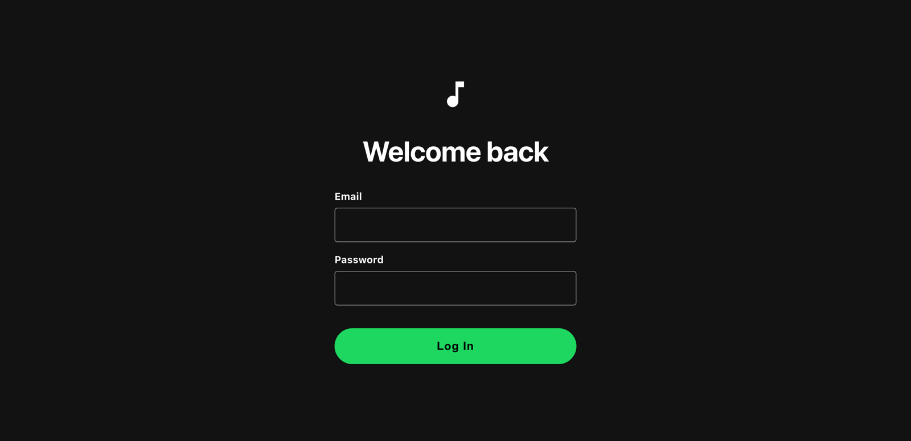
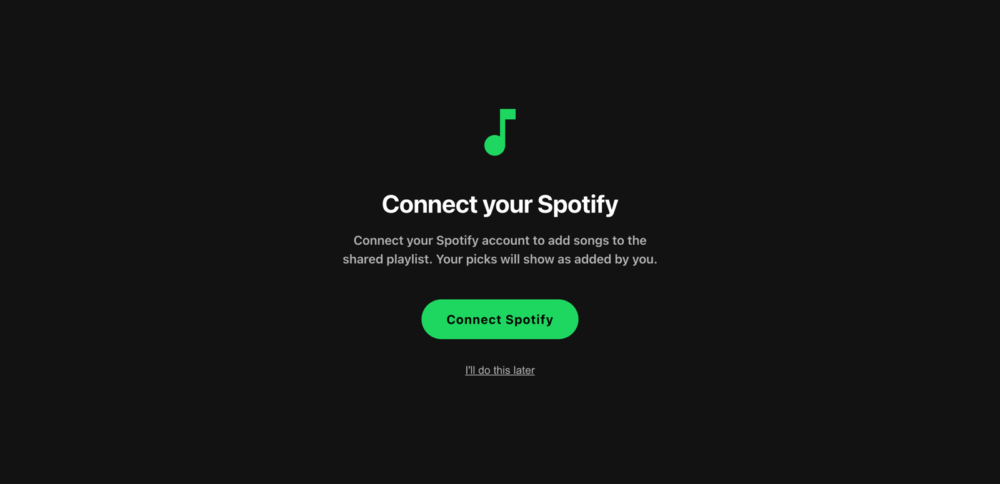
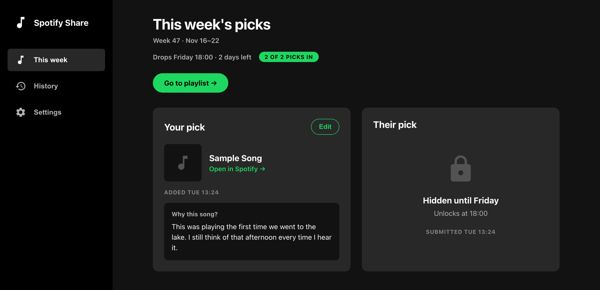

# Getting started

Set up Spotify Share on your own computer and save your first weekly pick.

## What you'll accomplish

In this tutorial, you run Spotify Share locally, connect it to Spotify and save your first song pick. You go from an empty folder to a working app.

By the end, you will:

- Have the server and the web app running on your computer.
- Sign in as one of the two users.
- Connect your Spotify account so the app can add songs in your name.
- Save a pick for this week and see it on the **This week** page.

This tutorial takes about 30 minutes. Most of that time is spent in the Spotify and Supabase dashboards.

It is written for developers who know how to use a terminal and npm. You do not need any experience with Supabase or the Spotify Web API.

## Prerequisites

Before you start, make sure you have:

- **Node.js 18 or later.** Check your version with `node --version`.
- **Git**, to clone the repository.
- **A Spotify account** for each of the two users.
- **A Supabase account.** The free plan is enough. [Supabase](https://supabase.com) is a hosted PostgreSQL database that also handles sign-in.
- **A Spotify playlist** that the songs will go into. Both users must be able to add songs to it.

## Step-by-step instructions

### Step 1: Get the code

Clone the repository and install the dependencies for the server and the client. The client is the web app you see in the browser. The server talks to Spotify and the database.

```bash
git clone https://github.com/teod05/spotify-share.git
cd spotify-share
npm install
cd client && npm install && cd ..
```

Both installs finish without errors.

### Step 2: Create a Spotify app

Spotify Share needs its own Spotify app so it can ask each user for permission to add songs to the playlist.

1. Open the [Spotify Developer Dashboard](https://developer.spotify.com/dashboard) and sign in.
2. Select **Create app**.
3. Enter any name and description.
4. Under **Redirect URIs**, add `http://127.0.0.1:8888/callback`. Spotify sends users back to this address after they approve access.
5. Under **Which API/SDKs are you planning to use?**, select **Web API**.
6. Save the app, then open its **Settings**.
7. Copy the **Client ID** and the **Client secret**. You need them in step 5.
8. Open **User Management** and add the email addresses of both users' Spotify accounts.

New Spotify apps run in development mode. In development mode, only the users you add in **User Management** can connect.

### Step 3: Set up the database

Spotify Share stores users and their picks in Supabase.

1. Open the [Supabase dashboard](https://supabase.com/dashboard) and create a new project.
2. Open the **SQL Editor** and run this script. It creates the three tables the app uses:

   ```sql
   create table playlist (
     playlist_id   text primary key,
     playlist_link text
   );

   create table users (
     id            bigint generated always as identity primary key,
     auth_id       uuid unique not null,
     name          text not null,
     email         text not null,
     refresh_token text,
     playlist_id   text references playlist (playlist_id),
     created_at    timestamptz not null default now()
   );

   create table songs (
     id          bigint generated always as identity primary key,
     user_id     bigint not null references users (id),
     song_link   text not null,
     description text not null,
     created_at  timestamptz not null default now(),
     posted_at   timestamptz
   );
   ```

   `posted_at` stays empty until the song is added to the playlist. `refresh_token` stays empty until the user connects Spotify.

3. Open **Authentication** > **Users** and select **Add user** > **Create new user**. Enter an email and a password, and select **Auto Confirm User**. Repeat this for the second user.
4. Copy each user's **User UID**.
5. Open the **SQL Editor** again and add both users to the `users` table. Replace the placeholders with your own values:

   ```sql
   insert into users (auth_id, name, email) values
     ('FIRST_USER_UID',  'Your name',    'you@example.com'),
     ('SECOND_USER_UID', 'Partner name', 'partner@example.com');
   ```

6. Open **Project Settings** > **API**. Copy the **Project URL** and the **service_role** key. You need them in the next step.

The `service_role` key gives full access to your database. Never commit it or share it.

### Step 4: Find your playlist ID

1. Open Spotify and go to the playlist you want to use.
2. Select **Share** > **Copy link to playlist**.
3. Copy the ID from the link. It is the part between `/playlist/` and `?`.

For example, in `https://open.spotify.com/playlist/3EssRQQTtRgom8M2ggURRr?si=abc`, the ID is `3EssRQQTtRgom8M2ggURRr`.

### Step 5: Add your settings

The server reads its settings from a file called `server/.env`. Copy the example file:

```bash
cp server/.env.example server/.env
```

Open `server/.env` and fill in the values from the previous steps:

```bash
SUPABASE_URL=https://YOUR_PROJECT.supabase.co
SUPABASE_SECRET_KEY=YOUR_SERVICE_ROLE_KEY

CLIENT_ID=YOUR_SPOTIFY_CLIENT_ID
CLIENT_SECRET=YOUR_SPOTIFY_CLIENT_SECRET
REDIRECT_URI=http://127.0.0.1:8888/callback

FRONTEND_URL=http://127.0.0.1:5173

SPOTIFY_PLAYLIST_ID=YOUR_PLAYLIST_ID

NODE_ENV=development
```

Git ignores `server/.env`, so your keys stay on your computer.

### Step 6: Start the app

Spotify Share runs as two processes. Start each one in its own terminal window.

In the first terminal, start the server:

```bash
npm run dev:server
```

You see:

```text
Server listening on port 8888
Environment: development
```

In the second terminal, start the client:

```bash
npm run dev:client
```

Vite (the tool that serves the web app during development) prints the local address, `http://127.0.0.1:5173/`.

To check that the server is ready, open a third terminal and run:

```bash
curl http://127.0.0.1:8888/api/health
```

The server answers with `{"ok":true}`.

### Step 7: Sign in

Open http://127.0.0.1:5173 in your browser.

Use `127.0.0.1` and not `localhost`. Spotify sends you back to `127.0.0.1` after you connect, and your sign-in cookie only works on the address where you signed in.



Enter the email and password of one of the users you created in step 3, then select **Log In**.

### Step 8: Connect Spotify

After you sign in for the first time, the app asks you to connect Spotify.



1. Select **Connect Spotify**.
2. Sign in to Spotify if it asks you to.
3. Select **Agree** to give Spotify Share permission to add songs to your playlists.

Spotify sends you back to the app. Your account is now connected. When the Friday drop runs, your songs are added with your Spotify account, so the playlist shows you as the person who added them.

### Step 9: Save your first pick

1. In Spotify, find a song you want to share. Open its menu and select **Share** > **Copy Song Link**.
2. In Spotify Share, select **Add your pick**.
3. Paste the link into **Spotify track link**.
4. Under **Why this one?**, write up to 280 characters about why you chose the song.
5. Select **Save pick**.

Your pick appears under **Your pick**, with the song title and your reason. The **Their pick** card shows whether your partner has picked yet. It stays locked until Friday at 18:00 Berlin time.



*The **This week** page, shown with sample data.*

## Recap

Well done. You now have Spotify Share running on your computer. In this tutorial, you:

- Created a Spotify app and a Supabase project for Spotify Share.
- Added your settings and started the server and the client.
- Signed in, connected Spotify and saved your first pick.

To try the full weekly swap, sign in as the second user in a private browser window and save a second pick. Both picks are added to the playlist at the next Friday drop.

## What's next

- **Put the app online.** The [deployment guide](DEPLOY.md) shows how to host Spotify Share on Render and run the Friday drop on a schedule with Supabase.
- **Run the tests.** See [Run the tests](../README.md#run-the-tests) in the README.
- **Report a problem.** If a step did not work for you, open an issue on [GitHub](https://github.com/teod05/spotify-share/issues).
